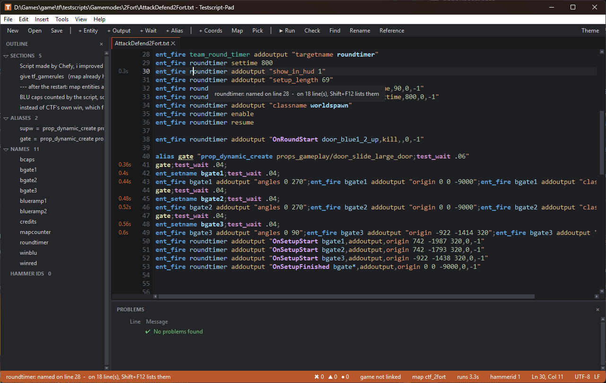
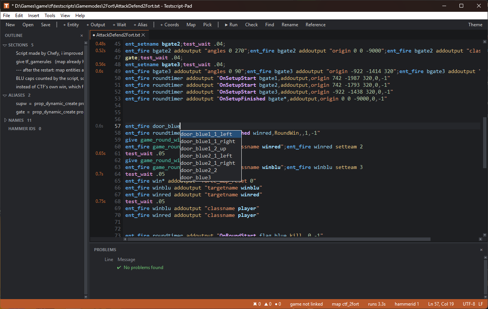
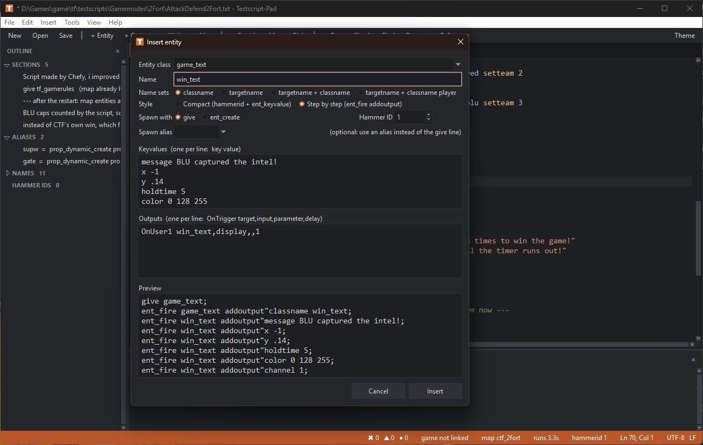
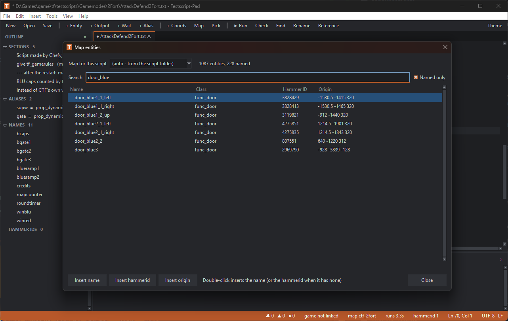
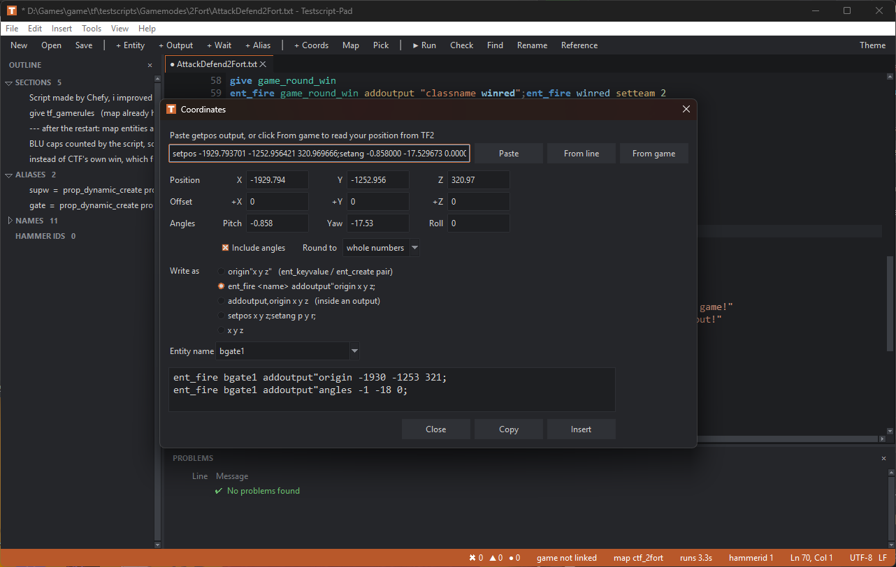
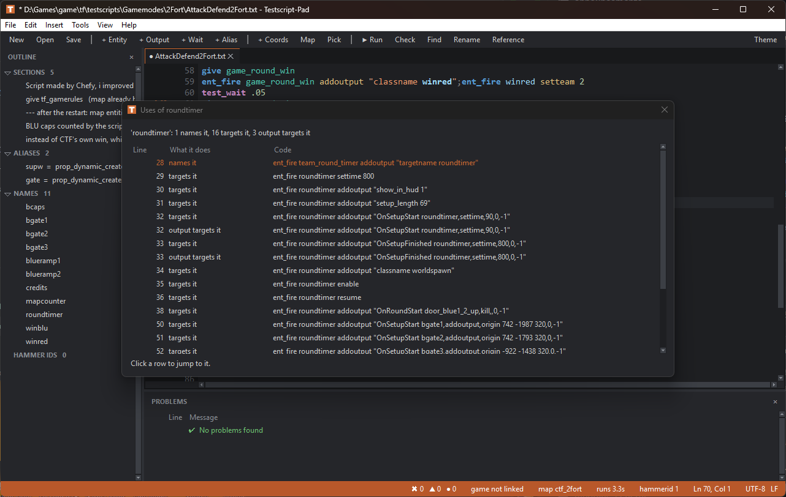

# Testscript-Pad

An editor for **Orange Box / TF2 testscripts** that understands the testscript language, so you don't have to write them in Notepad.

Testscripts are text files of console commands (`ent_fire`, `give`, `ent_keyvalue`, `Test_Wait`, ...) that the game runs from top to bottom. People use them to build whole gamemodes: KOTH on 2Fort, Payload on Dustbowl, CTF on Hydro, Zombie Fortress and so on. Testscript-Pad adds syntax highlighting, autocomplete, a script checker and builders for the long entity blocks these scripts are made of.



## Getting started

### The .exe (no Python needed)

Download **`Testscript-Pad.exe`** from the [Releases](https://github.com/Chefyie/testscript-pad/releases) page and run it. You can drag `.txt` testscripts onto it, or set it as the program that opens them. It's a single file and doesn't need installing. Windows SmartScreen may warn the first time, because the `.exe` isn't signed: choose *More info → Run anyway*.

### From source

You need Windows and [Python 3](https://www.python.org/downloads/) with tkinter, which the standard Windows installer includes. There are no extra packages.

1. Download or clone this repository.
2. Double-click **`Testscript-Pad.bat`**, or drag `.txt` testscripts onto it.

You can also run it directly:

```bash
pythonw testscript_pad.py path/to/script.txt
```

### Building the .exe yourself

Double-click **`build.bat`**. The first time, it creates a `.venv-build` folder and installs [PyInstaller](https://pyinstaller.org) into it, without touching your normal Python. The result is `dist\Testscript-Pad.exe`, which includes the game plugin if `plugin\build_plugin.bat` has been run. The icon comes from `assets\icon.ico`, which `tools\make_icon.py` draws.

The open dialog starts in `D:\Games\game\tf\testscripts` if that folder exists. Open tabs are restored the next time you start the editor.

## Features

### Syntax highlighting

| Color | Meaning |
|---|---|
| blue, bold | commands: `ent_fire`, `give`, `ent_keyvalue`, `alias`, ... |
| purple, bold | `Test_` commands: `Test_Wait`, ... |
| yellow, bold | your aliases (`a;`, `b;`, ...) |
| teal | entity classes: `logic_relay`, `math_counter`, ... |
| light blue | names and targets (bold where the name is defined) |
| gold | inputs: `addoutput`, `trigger`, `setteam`, ... |
| violet, bold | outputs: `OnTrigger`, `OnPass`, `OnCase01`, ... |
| orange | keyvalues: `origin`, `classname`, `hammerid`, ... |
| green, italic | `//` comments |
| red | the `///` end marker (everything after it is greyed out) |

Inside outputs, `"target,input,parameter,delay"` is colored field by field.

### Autocomplete

Suggestions appear as you type (or press `Ctrl+Space`) and depend on where the cursor is:

- **First word:** commands and your aliases
- **After `ent_fire`:** names and classes, then inputs
- **Inside `addoutput"...`:** keyvalues and outputs
- **After an output:** targets, then inputs after the first comma
- **After `ent_keyvalue`:** your hammerids
- **After `prop_dynamic_create`:** models

The status bar explains the word under the cursor: what a command, input or output does, what an alias expands to, or which entity a hammerid belongs to.



### Script checker

The **Problems** panel updates as you type. `F5` runs the check and `F8` jumps to the next problem. It flags:

- a missing `///` at the end (without it the last lines of the script don't run correctly; **Run in game** offers to add it), or lines after the `///` that will be ignored. Only a line that is just `///` ends the script: `///Heading` and `//////` lines are ordinary comments.
- `ent_keyvalue` on a hammerid that was never assigned
- `ent_keyvalue` right after `addoutput"hammerid N` with no `Test_Wait` in between (`ent_fire` is queued, so the entity doesn't have the id yet)
- the same hammerid assigned twice, or the same targetname given to two new entities
- `Test_Wait` without a number (e.g. `test_wait .1:`)
- `ent_fire` whose target looks like an input (a missing space or a doubled word)
- unknown commands (typos, undefined aliases) and unknown entity classes
- outputs with too many fields, and unused or redefined aliases

### Builders

- **Entity... (`Ctrl+E`)** writes the whole spawn block for you, in either style:
  - compact: `give x;ent_fire x addoutput"hammerid N";test_wait .1;ent_keyvalue N ...`
  - step by step: `give x;` then `ent_fire x addoutput"classname name;` ... `Test_Wait .1;`
- **Output... (`Ctrl+Shift+O`)**, **Alias...**, **Test_Wait** (`Ctrl+T`), **next free hammerid** (`Ctrl+I`)
- Snippets for point_clientcommand/point_servercommand, respawn times and goal text, restart round, and `///`



### Run in game

Press **`F9`** (or **▶ Run** on the toolbar). The editor saves the script and then:

- **If TF2 isn't running,** it starts `hl2.exe` with your launch options, loads the map that matches the script's folder, skips *waiting for players*, closes the welcome and team menus, joins a team as **Scout** (you can change the team and class in Game settings), waits a few seconds, and runs the script. For example, `Gamemodes/2Fort/KOTH.txt` loads `ctf_2fort`, `Dustbowl` loads `cp_dustbowl` and `Hydro` loads `tc_hydro`. It does this through a small launcher testscript, `tf\testscripts\testscript_pad_launch.txt`, which is rewritten on every run and is safe to delete.
- **If TF2 is already running,** it sends `test_startscript <script>` to that game with `-hijack` instead of opening a second copy.

Either way, the `test_startscript Gamemodes/2Fort/KOTH.txt` command is also copied to the clipboard. `Ctrl+F9` only copies it, without launching.

The script must be saved somewhere under `tf\testscripts\`. The game folder (the one with `hl2.exe`) is found from where the script is saved. You can set it yourself under **Tools → Game settings...**, along with:

- **Launch options:** `-testscript` is added for you. The default is `-game tf 440 -sw -w 1920 -h 1080 -port 27016 -novid -dev -console -insecure -toconsole -nohltv -nomaster`.
- **Map to load:** auto (from the folder name), a fixed map, or none (run the script straight at startup)
- **Map when the folder has no match:** used for scripts in folders like `Any`. The default is `ctf_2fort`.
- **Seconds to wait before the script starts:** default 20. The countdown starts when the map starts loading, and connecting to your own server takes around 13 seconds on 2Fort. Starting a script before you're in the game crashes TF2, so raise this if the game crashes on launch.
- **Run in the already-running game:** on by default
- **Clipboard command:** `{path}` is the path from the testscripts folder, `{name}` is just the file name

### Game link

When **Run in game** starts TF2, it adds `-usercon -condebug +rcon_password <password>`, so Testscript-Pad can talk to the game over its remote console (RCON). The password is random, made once and kept in your settings. The game's address is found automatically. Then:

- **`F9` with TF2 open** runs the script inside it over the link. If the link isn't available (for example, the game was started from `client.bat`), it falls back to `-hijack`.
- **Game console (`` Ctrl+` ``)** shows the game's console live (from `tf\console.log`), and you can type commands that run in the game, with Up/Down for history.
- **From game**, in the coordinate dialog, or **Position from game (`Ctrl+Shift+P`)** reads where you're standing (`getpos`) straight into the coordinate dialog.
- **The status bar** shows *game linked* / *game not linked*. Click it to connect to a game that's already running.

Turn it off under **Tools → Game settings...** if you don't want RCON on.

### Game plugin

`plugin/` holds a small C++ server plugin for TF2 (`testscript_pad.dll`). It adds console commands that the editor uses over the game link:

| Command | What it prints |
|---|---|
| `tsp_pick [pitch yaw]` | the entity under your crosshair, plus the exact point you're aiming at |
| `tsp_ents [text]` | every live entity, including ones your script created |
| `tsp_find <hammerid\|name>` | one entity's class, name, hammerid, origin and angles |

In the editor:

- **Pick (`Ctrl+Shift+E`)** asks the game what you're looking at. Things that aren't solid, like the intel, triggers and logic entities, are found too. You can insert its name, hammerid, origin, angles, or the **aim point**, which is handy for placing props exactly where you're looking.
- **Game entities** lists everything that exists in the game right now, searchable. Unlike **Map entities**, it also shows entities your script made while running.

**Install it** with **Tools → Game settings... → Testscript-Pad plugin → Install / update**, with TF2 closed. That copies the DLL and `testscript_pad.vdf` into `tf\addons`, and TF2 loads it at startup (it needs `-insecure`, which the default launch options have). The release `.exe` carries the plugin inside it.

**Building it yourself** needs Visual Studio with *Desktop development with C++*. Run `plugin\build_plugin.bat`. The first time, it downloads the Orange Box SDK headers ([alliedmodders/hl2sdk](https://github.com/alliedmodders/hl2sdk), `orangebox` branch) into `.sdk`. Then run `build.bat` again so the `.exe` includes the new DLL.

### Map entities

The editor reads the entities out of the script's map (`tf\maps\<map>.bsp`). It picks the map from the script's folder, the same way **Run in game** does (`Gamemodes/2Fort/...` → `ctf_2fort`). With that it knows every entity the map already has:



- **Autocomplete** suggests map names (`flag_blue`, `door_blue1_2_up`, ...) as targets, and their hammerids after `ent_keyvalue`.
- **The status bar** explains map names and hammerids. Put the cursor on `418237` in a Hydro script and it says *tc_hydro entity – trigger_multiple at 1664 2088 24*.
- **The checker** flags targets that neither the script nor the map has (usually a typo or a missing entity), and `ent_keyvalue` hammerids the map doesn't contain. Wildcards, `kill` on missing entities, and entities the game creates while running (`spotlight_end`, `tf_weapon_*`, ...) are left alone.
- **Map entities... (`Ctrl+M`)**, or **map** in the status bar, opens a searchable list of the map's entities with class, hammerid, origin and outputs. You can insert a name, hammerid or origin from it, and choose which map the script is for when the folder name doesn't say (scripts in `Any`, for example).

### Coordinates

**Coordinates... (`Ctrl+P`)** turns positions into script text:

1. Type `getpos` in the TF2 console and copy the `setpos ...;setang ...` line it prints.
2. Open the dialog. It picks up the copied line from the clipboard automatically. You can also paste it, type the numbers, or click **From line** to read the `origin`/`angles` already on the cursor line.
3. Add an offset if you want (for example `-64` on Z), choose how to round, and pick a format:
   - `origin"x y z"`, for `ent_keyvalue` and `ent_create`
   - `ent_fire <name> addoutput"origin x y z;`
   - `name,addoutput,origin x y z`, for use inside an output
   - `setpos x y z;setang p y r;`
   - plain `x y z`
4. Click **Insert** or **Copy**.

To fine-tune a number in place, put the cursor on it and press `Ctrl+Alt+Up` / `Ctrl+Alt+Down` (±1), or add `Shift` for ±10.



### Timing

The gutter shows **when each line runs**: the total `Test_Wait` time before it (`0.5s`, `12.5s`, `1:05.2`). The time appears wherever it changes, and in grey on the cursor line. Waits inside aliases count too. The status bar shows how long the whole script takes (*runs 11.1s*). Turn the column off under **View → Timing column**.

### Hover help

Rest the mouse on a word to see what it is: what a command, input or output does, what an alias runs, where a name is made and how many lines use it, which map entity a hammerid is, and any problem on that spot. Outline and problem rows that are cut off show their full text on hover. Turn it off under **View → Hover help**.

### Who uses this name

**Shift+F12**, the right-click menu, or a right-click on a name in the outline lists every line that uses a name:

- **names it:** `addoutput"targetname cph`, `ent_setname`, `classname`
- **targets it:** `ent_fire cph ...`
- **output targets it:** `"OnTrigger cph,setowner,2"`
- **targets it (wildcard):** `ent_fire cou* ...` also hits `countred`

It also mentions when the map already has an entity with that name. Click a row to jump to it.



### My snippets

Select some lines and use **Save selection as snippet...**, from **Insert → My snippets** or the right-click menu. Insert them again from that menu, or press **`Ctrl+J`** for the list at the cursor. Write `{hid}` where a hammerid goes (`{hid+1}`, `{hid+2}` ... for more) and it becomes the next free hammerid when inserted, so one entity block can be reused without clashes. **Manage snippets...** edits, renames and deletes them.

### Auto-backup

Every 30 seconds, tabs with unsaved changes are copied to `%APPDATA%\Testscript-Pad\backups`. Saving or closing a tab removes its backup, and so does closing the editor normally. If Testscript-Pad or Windows crashes, the next start lists the scripts with unsaved changes and offers to reopen them. They open as unsaved, and the files on disk are left as they were until you save.

### Tools

- Rename a name everywhere (`F2`)
- Split `;`-joined commands onto separate lines, or join selected lines into one
- Expand aliases into a new tab
- Remove comments into a new tab
- Searchable language reference (`F1`)

### Layout

- **Toolbar** for the common actions (hover over a button to see its shortcut)
- **Tabs:** an × on each tab closes it, or middle-click the tab
- **Panels:** an × on the **Outline** / **Problems** headers hides them, and the View menu brings them back. Drag the dividers to resize; sizes are remembered.
- **Outline:** sections (`//` comment lines), aliases, names and hammer IDs. Click one to jump to it.
- **Status bar:** problem counts (click one to jump to the next problem), next free hammerid, line/column, encoding and line endings
- Dark and light themes, zoom with `Ctrl+mouse wheel`

### Editing

- Find/replace with regex (`Ctrl+F` / `Ctrl+H`), go to line (`Ctrl+G`)
- Toggle comment (`Ctrl+/`), duplicate line (`Ctrl+D`), move lines (`Alt+Up/Down`)
- Files keep their original encoding and line endings when saved

## Keyboard shortcuts

| Shortcut | Action |
|---|---|
| `Ctrl+Space` | Autocomplete |
| `Ctrl+E` | Insert entity |
| `Ctrl+Shift+O` | Insert output |
| `Ctrl+T` | Insert `Test_Wait .1` |
| `Ctrl+I` | Insert next free hammerid |
| `Ctrl+P` | Coordinates (getpos → origin / setpos) |
| `Ctrl+M` | Map entities |
| `` Ctrl+` `` | Game console |
| `Ctrl+Shift+P` | Position from game |
| `Ctrl+Shift+E` | Pick what you're looking at (plugin) |
| `Ctrl+Alt+Up` / `Ctrl+Alt+Down` | Number under the cursor +1 / −1 (add `Shift` for ±10) |
| `F9` | Run in game (save, then launch TF2 or send to the running game) |
| `Ctrl+F9` | Copy the `test_startscript` command only |
| `Ctrl+/` | Toggle comment |
| `Ctrl+D` | Duplicate line |
| `Alt+Up` / `Alt+Down` | Move line |
| `F2` | Rename a name everywhere |
| `Shift+F12` | Who uses this name? |
| `Ctrl+J` | My snippets |
| `F5` | Check script |
| `F8` / `Shift+F8` | Next / previous problem |
| `Ctrl+F` / `Ctrl+H` / `F3` | Find / replace / find next |
| `Ctrl+G` | Go to line |
| `Ctrl+Tab` | Next tab |
| `F1` | Language reference |

## Project layout

| File | Purpose |
|---|---|
| `testscript_pad.py` | the editor window |
| `tslang.py` | the testscript language: vocabulary, highlighting, autocomplete context, checker |
| `mapdata.py` | reads the entity list out of `.bsp` map files |
| `gamelink.py`, `rcon.py` | the connection to a running TF2 (RCON) |
| `plugin/` | the C++ game plugin and `build_plugin.bat` |
| `Testscript-Pad.bat` | Windows launcher |
| `build.bat`, `tools/make_icon.py`, `assets/icon.ico` | building the `.exe` |

Settings are stored in `%APPDATA%\Testscript-Pad\settings.json`.

To teach the editor new commands, inputs, outputs, keyvalues or entity classes, add a line to the matching table at the top of `tslang.py` (`name | description`).

## License

[MIT](LICENSE) © 2026 Chefy
